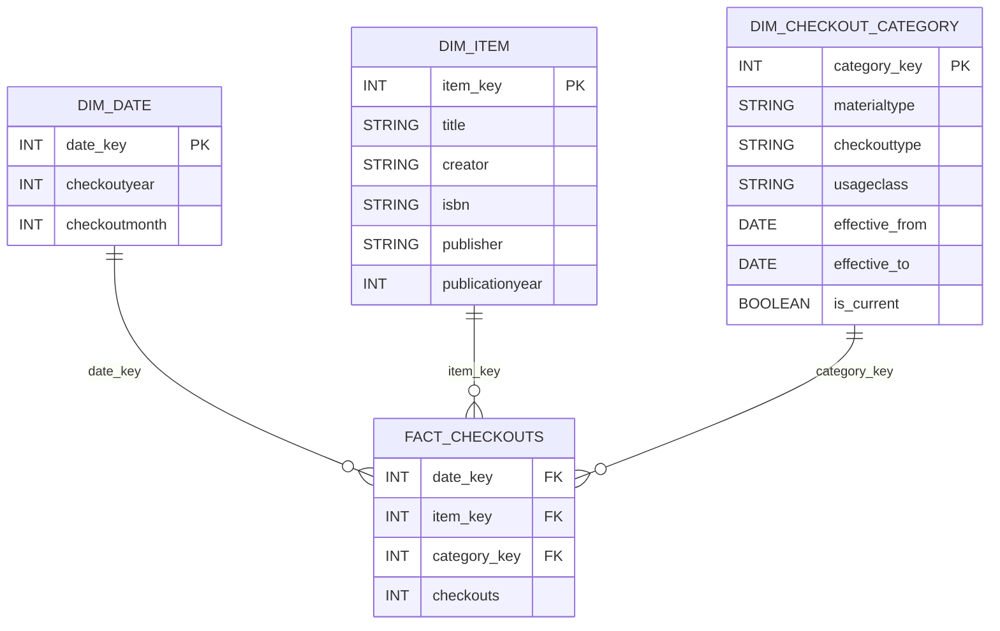

# P1 - Grain, Model, History, & Pipeline Plan
### Cally Minner
### SEIS 732, Fall 2026

## Establish the Question and Check the Source
The acquisition committee for an indie publishing house needs a way to view historical book trends in the last 20 years to determine the projected trends to guide the manuscript acquisition process and to make informed decisions that would benefit the company.

The primary questions are what are the historical book trends over the last 20 years and what are the project future trends based on this historical data?

I will be using the `books_project` dataset and the `books` table in BigQuery. This dataset includes 2 million rows with 100,000 rows of aggregated data for each year between 2006-2025. This means I am not looking at individual checkout transactions, but rather the amount of checkouts per month for a given book.

Proposed grain: One row represents the number of `checkouts` for a specific `title`, by `creator`, during a particular `checkoutmonth` and `checkoutyear`, categorized by `materialtype`, `checkouttype`, and `usageclass`.
- Interestingly, there are currently 514 identified rows that are repeated key groups.
- There is also no unique ID for each row.

## Define the Model and Predict a History Consequence
Business Process: 

Fact Table: Periodic snapshot. We are looking at the amount of checkouts per month for a given book over a 20 year period.

Proposed Grain: One row represents the number of `checkouts` for a specific `title`, by `creator`, during a particular `checkoutmonth` and `checkoutyear`, categorized by `materialtype`, `checkouttype`, and `usageclass`.

Principle Fact: `checkouts`

Using the proposed schema below, I will look at how library checkout patterns have changed over a 20 year timespan to then apply this understanding for future projections. Knowing what the current trends are will help make the best decision from a business standpoint on what type of manuscripts should be acquired for the publishing house.

Star Schema:

One attribute that could cause issues is `materialtype`. This notates whether the book that was checked out was a physical book, and ebook, an audiobook, etc. However, a publishing house doesn't care about the media type, just the title or genre. It may make sense to aggregate all titles month by month regardless of media type. There also might be different ways of notating the type. For example, ebook versus electronic book. This could be a Type 1 fix as it would just need to be standardized and edited, the version history in this case is not necessary and therefore wouldn't need a Type 2 handling. However, Type 2 handling could be helpful in preserving the documentation styles of the time period (with electronic media before 2022 and ebook after 2022, for a fake example). This is something I will have to deliberate further before P3 as it may or may not be something I use to answer my primary question. Although it could be useful information for secondary questions from a monetary standpoint (ebooks don't have the same printing costs). Additionally, while ISBN is included as an attribute in the item dimension, it is important to note that until the year 2022, the ISBN was not included in the dataset.

## Plan the Build and its Checks
|Layer|Planned Object|Purpose|
|---|---|---|
|Raw|`raw_library_checkouts`|Preserve the 2 million imported records with their original source fields and values.|
|Curated|`curated_library_checkouts`|Standardize data types, handle missing values, validate the proposed grain, and prepare consistent material-type classifications.|
|Serving|`FACT_CHECKOUTS`, `DIM_DATE`, `DIM_ITEM`, `DIM_CHECKOUT_CATEGORY`|Organize the curated data into a star schema for analyzing checkout patterns by year and material type.|
|Serving|`checkout_trends`|Provide annual checkout summaries by material type for reporting and visualization.|

### Preliminary Run Order:
1. Load the 20 CSV files into BigQuery
2. Test the grain
3. Check row counts, missing values, duplicates
4. Handle missing information, standardize data, handle the `materialtype` issue
5. Create the fact table and the dimension tables
6. create `checkout_trends`
7. Make sure everything works and runs smoothly. Check the grain again

|Stage|Field or Output|Planned Transformation|
|---|---|---|
|Source CSV|`checkouts`|Original monthly checkout count|
|Raw|`checkouts`|Preserve the source value|
|Curated|`checkouts`|Validate numeric type and check for null or negative values|
|Serving fact|`FACT_CHECKOUTS.checkouts`|Retain the measure at the source record grain|
|Audience view|`total_sampled_checkouts`|Calculate SUM(checkouts) grouped by `checkoutyear` and `title`|

One risk is that this dataset only contains 100,000 randomly selected rows for each year between 2006-2025 from a dataset that had over 51 million total rows. Because of this, the dataset does not provide the entire picture of library checkouts at the Seattle Public Library and will only provide a limited understanding of book trends over the years. I intend to check each year to see how often each month is represented as this may skew the reality for that year if one month was sampled way more than the others.

Another risk is the over 300,000 rows that have at least one missing value, and the 514 repeated grain groups. Depending on what attributes are missing values, I would likely fill the numerical data types with the average and the categorical data types with the mode. I don't think this makes sense if `title` is missing in any rows, something I will have to consider as I come across it. The 514 repeated grain groups doesn't currently concern me because the `checkouts` might still be different, which can actually tell an interesting story if that is the case. 

The last risk is the missing ISBN through the year 2021. The `ISBN` is the best way to ID a book, but the majority of this dataset does not have any information on the `ISBN` for the books. Because of this, I will need to go through the `title`s and `materialtype`s to group the same books together.

In terms of data privacy and access, there is no senstive information included in this dataset and anyone could access it from the data.gov site. That being said, the curated, serving, and audience tables will only have access granted to the intended recipients (in this case, different members of the acquisition committee depending on their role). 

The largest limitation currently is likely the fact that this dataset is only a limited view of the Seattle Library's checkout history. However, because this is intended for an indie publishing house to view historical book trends, this may not be too big of an issue as long as the frequency of samples for each month in each year is taken into account.

### Diagnose and Revise the Plan
Peer review was completed in class.

Note: Used AI to help with Google BigQuery loading of the dataset, creating a bucket, and then the mermaid code.

